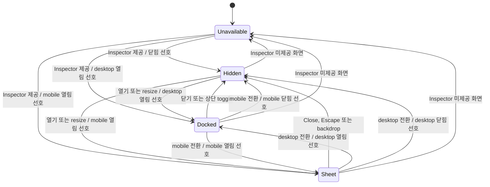
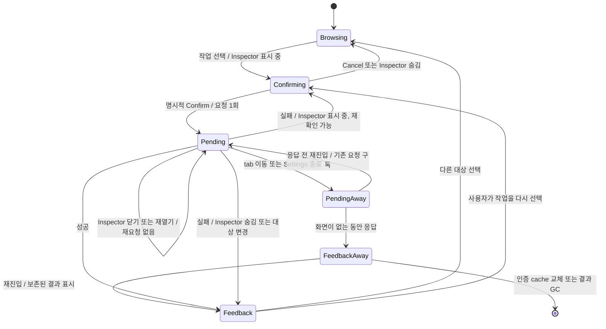
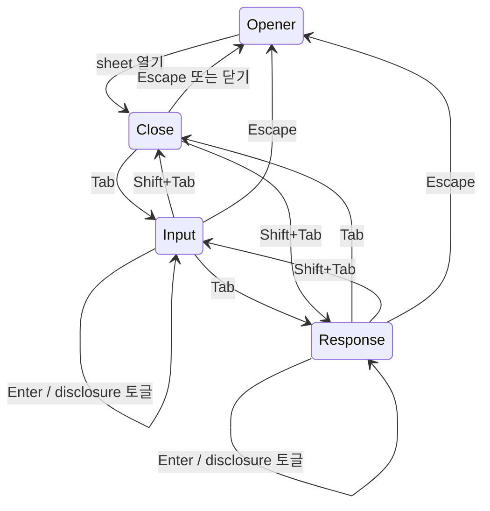
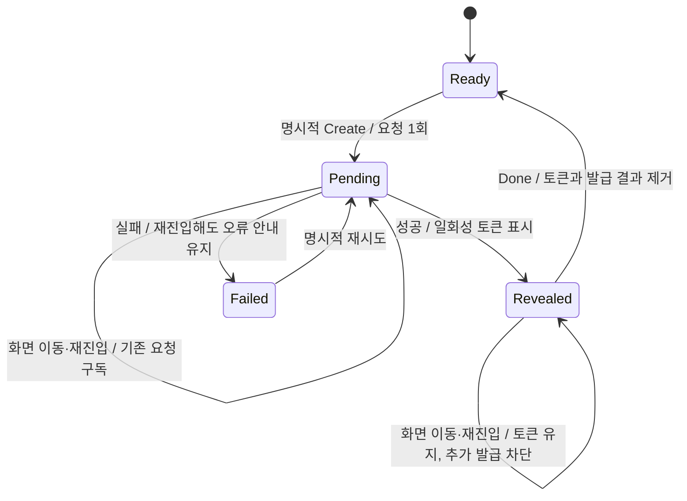

# Settings 상태 전환

Settings의 표시 상태와 기능별 작업 상태는 독립적이다. 이 문서는 기존 React state와 query mutation의 동작 계약을 FSM으로 표현한다. 별도 런타임 상태 머신이나 서버 API는 도입하지 않는다.

## 1. Inspector 표시 FSM



표시 상태는 `available`, 현재 viewport의 `open`, `isMobile`에서 계산한다. 사용 가능한 화면으로 돌아올 때 desktop의 열림 선호는 다시 적용할 수 있다. Mobile에서 Inspector를 제공하지 않는 화면으로 이동하면 열림 상태를 해제한다.

- 공통 `WorkbenchSurface`는 탭·본문과 Inspector의 표시 위치를 소유한다. Account는 기능이 본문과 Inspector를 함께 `renderPage`에 전달하고, Settings Workbench는 탭에서 제공 여부를 계산한다. 나머지 설정은 기존 portal container를 사용한다. Layout을 공유해도 선택·확인·요청 상태의 소유자는 바뀌지 않는다.
- 탭 바는 기능 controller 위에 유지한다. 탭을 바꿀 때 본문·Inspector의 기능은 제거되지만 탭 DOM은 유지하므로 방향키·Home·End 탐색의 focus가 본문 제목으로 이동하지 않는다.
- 복원한 작업 결과는 기존 탭 탐색의 focus를 가져가지 않는다. History 종류 선택도 목록 controller 위에 유지하므로 종류 전환 후 같은 컨트롤에서 키보드 조작을 이어갈 수 있다.
- Inspector의 제공 여부는 상단 toggle과 표시 내용이 어긋나지 않도록 layout effect에서 외부 chrome에 반영한다. Account의 확인·결과 focus는 Inspector 내용의 DOM mount 시점에 적용하며, 기능이 portal container를 참조하지 않는다.
- Feature는 선택 대상·확인 UI를 소유한다. Portal의 unmount를 feature의 unmount로 간주하지 않는다.
- 요청의 진행 상태·대상·결과는 인증별 query cache가 소유한다. Feature는 현재 작업을 구독해 잠금과 결과 안내를 복원한다.
- Inspector가 닫혀도 본문의 탐색·추가·필터는 사용할 수 있다. 진행 중 요청 때문에 일시적으로 비활성화하는 경우는 다음 FSM을 따른다.

## 2. 파괴적 작업 FSM

Account의 브라우저 로그아웃, Connections의 연결 해제, Agents의 삭제, Trash의 영구 삭제에 같은 닫기 규칙을 적용한다.



| 전환·경계 | 반드시 지킬 동작 |
| --- | --- |
| 확인 중 → Inspector 닫기 | 미확정 작업을 취소한다. 목록과 새로고침의 확인 상태 잠금을 해제한다. 요청은 보내지 않는다. |
| 요청 중 → Inspector 닫기 | 이미 보낸 요청을 취소·재전송하지 않는다. 요청 때문에 잠근 조작은 응답을 처리할 때까지 잠근다. |
| 닫힌 상태에서 응답 도착 | 성공·실패 결과를 보존하고 미확정 확인 상태를 해제한다. 다시 열 때 오래된 Confirm을 복구하지 않는다. |
| 표시 중 실패 | 사용자가 확인 후 재시도할 수 있다. Trash의 404·409는 확인을 해제하고 목록을 새로 조회한다. |
| Cancel | 실행 버튼으로 focus를 돌린다. Inspector 닫기는 sheet의 opener 복귀 규칙을 따른다. |
| viewport 변경 | 변경 후에도 Inspector가 표시된다면 확인 상태를 유지한다. 숨겨진다면 닫기 규칙을 적용한다. |
| tab 변경·Settings 종료 | UI의 확인 상태를 버린다. 요청은 query cache에서 계속 추적하며 재진입 시 잠금과 결과를 복원한다. |

`Away`는 feature가 unmount된 상태를 나타내는 명세상의 구분이다. 별도 서버 상태가 아니다. 인증별 query cache의 keyed mutation을 구독하며, `trash`, `revoke-browser/cli/mcp`, `delete-agent`의 작업 범위를 분리한다. API key 폐기의 `revoke-api-key`는 key 목록의 query key로도 범위를 나눠 에이전트 사이에 상태가 섞이지 않게 한다. 같은 범위의 요청이 진행 중이면 호출 시점에도 중복 실행과 reset을 막는다. 완료 결과는 사용자가 다른 대상을 선택하거나 새 작업을 확인할 때 해제하고, cache의 기존 GC 정책을 따른다. 브라우저 새로고침·로그아웃을 넘어 보존하지 않는다. API key 원문은 이 경로로 옮기지 않는다.

API key 폐기는 본문에서 확인하므로 Inspector 닫기에 영향을 받지 않는다. 탭 변경·Settings 종료로 본문이 제거되면 미전송 확인은 버리고, 이미 전송한 요청의 잠금·결과는 같은 cache 수명 규칙으로 복원한다.

성공 후 서버 자원 갱신은 mutation callback이 수행한다. 화면 안내·선택 변경은 구독한 결과로 계산하므로 제거된 화면의 setState에 의존하지 않는다. Trash의 삭제 성공은 정리 완료가 아닌 `Deletion queued`다.

전환 처리 후의 불변 조건:

- Inspector 숨김 + 요청 없음 → 확인 상태 없음.
- 요청 중 → Inspector 표시 여부와 무관하게 요청으로 잠근 조작을 유지.
- 닫기·재열기·resize → mutation 전송 횟수 증가 없음.
- 요청 중 tab 왕복·Settings 재열기 → 새 요청 없이 기존 요청의 잠금과 결과 복원.
- 재시도 → 사용자의 명시적 Confirm 필요.

## 3. Mobile sheet의 focus FSM



이 도식은 다른 focusable content가 없는 호출 상세의 기본 순서다. Native `summary`도 Tab 순환에 포함한다. 명시적 autofocus가 있으면 유지하며, sheet 종료 중 새 화면으로 옮겨진 focus를 오래된 opener로 덮어쓰지 않는다.

## 4. API key 발급 결과의 수명



발급 상태는 파괴적 작업의 `settings-operation`과 분리한다. 인증별 QueryClient의 메모리에서 정확한 API key query key별로 보관하므로 에이전트나 로그인 계정 사이에 결과가 섞이지 않는다. 진행 중 요청과 확인하지 않은 성공 결과는 화면이 없어져도 유지하고, 다른 발급으로 덮어쓰지 않는다. `Done`은 보관된 mutation과 토큰을 제거한다. 브라우저 저장소에 원문을 기록하거나 서버에서 원문을 다시 조회하는 기능은 추가하지 않는다. 페이지 새로고침이나 인증 cache 교체를 넘어 보존하지 않는다.

복원된 결과는 Settings 탭의 키보드 탐색 focus를 가져가지 않는다.

인증 cache의 경계는 실제 `account.id`다. `/me`가 성공 응답으로 다른 계정을 반환한 경우에도 이전 계정의 Workspace를 숨기고 cache를 교체한 뒤 새 계정을 다시 확인한다. 다른 탭의 로그인으로 쿠키만 바뀐 경우도 같은 규칙을 따른다. 이전 계정에서 늦게 끝난 발급 요청은 새 계정의 cache나 화면에 결과를 전달하지 않는다. 같은 계정의 재조회는 cache와 미확인 토큰을 유지한다.

이 경계에서 메모리의 선택 공간·편집 그룹·일시 상태도 초기화한다. 저장된 space별 snapshot과 레이아웃 선호는 삭제하지 않는다. 이미 서버로 보낸 작업 자체는 취소하지 않지만, 이전 cache의 세션 폐기·Space/Node 작업·본문 저장/복원 완료가 새 계정의 로그아웃·편집창 선택·저장 상태로 연결되지 않게 한다. 비동기 callback은 전역 UI 변경 직전에도 현재 cache인지 확인한다. 현재 브라우저 폐기 후 별도 로그아웃 요청을 기다리는 경우에도, 해당 요청이 끝난 뒤 cache를 다시 확인한다. 이전 계정의 늦은 성공·실패는 새 계정의 저장된 워크벤치나 미저장 초안을 지우지 않는다.

## 5. Workspace와 Library 왕복

Space Workspace는 Space Library나 Settings를 표시하는 동안에도 mounted 상태를 유지한다. 비활성 영역에는 `hidden`, `inert`, `aria-hidden`을 함께 적용해 보이지 않는 편집기로 focus나 조작이 이동하지 않게 한다. 같은 공간으로 돌아오면 기존 편집 세션과 미저장 초안을 그대로 사용한다. 다른 공간 선택은 기존 공간 전환 동작을 따른다.

이 보존은 현재 페이지의 메모리 수명에 한정된다. 저장된 pane snapshot에 문서 본문이나 미저장 초안을 추가하지 않는다. 화면을 숨기는 동안에도 기존 query observer는 mounted 상태로 남는다.

편집기의 mounted 상태와 화면의 활성 상태는 별개다. Library나 Settings로 이동하면 Workspace의 context menu와 Version history 같은 일시적 UI는 닫는다. 늦게 끝난 lazy import도 비활성 Workspace에서 portal을 표시하지 않는다. Workspace로 돌아왔을 때 초안은 복원하지만 닫은 팝업은 다시 열지 않는다.

외부 변경의 본문 조회가 진행 중이면 편집기의 자동 재조회는 기다린다. 조회 완료 뒤 현재 본문 SHA와 최신 metadata를 다시 비교해, 같은 revision이면 추가 요청 없이 끝내고 metadata가 더 최신이면 그때 본문을 다시 읽는다. 수동 reload와 미저장 초안의 충돌 처리 규칙은 유지한다.

본문 조회가 query의 재시도를 소진하면 오류 화면에서 명시적으로 Retry할 수 있다. 이 동작은 본문 조회만 다시 실행하며 진행 중에는 중복 실행을 막는다. 성공하면 수정하지 않은 편집기는 최신 본문을 표시하고, 미저장 초안이 있으면 초안과 기존 저장 기준 SHA를 유지한다. 초안을 교체하는 Reload와는 다른 동작이다.

## 6. 낮은 화면의 버전 비교

터치 화면의 44px 조작 영역은 화면 높이가 낮아져도 유지한다. Version history의 비교 영역과 전체 본문에는 기존 최소 읽기 높이를 적용하고, 모달 콘텐츠가 공간을 초과하면 바깥 콘텐츠 영역을 스크롤한다. 고정 비교 헤더와 도구 모음 때문에 본문을 읽을 공간이 사라지도록 비교 영역만 축소하지 않는다.

## 전환 검증

- [`auth-owner-transition.spec.ts`](../../frontend/web/e2e/auth-owner-transition.spec.ts): 같은 브라우저의 다른 탭에서 쿠키를 교체하고 실제 `/me` 성공 응답으로 계정 변경을 감지한다. 이전 토큰·에이전트 cache와 늦은 발급 결과가 새 계정에 노출되지 않는지 확인한다.
- [`auth-late-workspace.spec.ts`](../../frontend/web/e2e/auth-late-workspace.spec.ts): 이전 계정의 늦은 Space 생성·로그아웃 응답 완료 후에도 새 계정의 실제 미저장 문서 초안이 유지되는지 확인한다.
- [`useWorkbenchActions.test.tsx`](../../frontend/web/src/features/workbench/useWorkbenchActions.test.tsx): 로그아웃 성공·실패 후 인증 cache를 다시 확인하고, 같은 계정의 정리와 새 계정의 워크벤치 보존을 확인한다.
- [`App.authOwnership.test.tsx`](../../frontend/web/src/app/App.authOwnership.test.tsx): 실제 App의 인증 경계에서 같은 계정 유지, 다른 계정의 첫 protected commit, 이전 계정의 늦은 응답, 로그아웃·401의 cache 폐기를 확인한다.
- [`workbench-persistence.spec.ts`](../../frontend/web/e2e/workbench-persistence.spec.ts): desktop/mobile의 Library·Settings 왕복에서 실제 미저장 초안 보존, 숨겨진 편집기 조작 차단과 다른 공간 전환.
- [`text-revisions.spec.ts`](../../frontend/web/e2e/text-revisions.spec.ts): 낮은 터치 가로 화면에서 실제 변경 행·전체 본문을 읽고 이동·확인 취소·닫기를 조작한다.
- [`useTextEditorSession.integration.test.tsx`](../../frontend/web/src/features/editor/useTextEditorSession.integration.test.tsx): 외부 본문 조회와 metadata 도착 순서, 더 오래된 본문 응답의 후속 갱신, 실패 시 query retry 정책과 초안 보존을 확인한다.
- [`TextEditorView.recovery.test.tsx`](../../frontend/web/src/features/editor/TextEditorView.recovery.test.tsx): 실제 오류 화면에서 수동 재시도, 진행 중 중복 요청 차단, 미저장 초안과 저장 기준 SHA 보존을 확인한다.
- [`key-mint-navigation.spec.ts`](../../frontend/web/e2e/key-mint-navigation.spec.ts): 발급 대기·완료 후 에이전트 목록·Settings 탭·Settings 종료 왕복, 토큰 복원, 중복 발급 차단과 Done 후 제거.
- [`settings-transitions.spec.ts`](../../frontend/web/e2e/settings-transitions.spec.ts): desktop/mobile에서 4개 기능의 닫기 경로·재열기·resize, desktop tab 변경, 미전송 보장, 요청 중 Inspector·tab·Settings 재진입과 이후 성공·실패의 중복 전송 방지.
- [`useSettingsMutation.test.tsx`](../../frontend/web/src/features/settings/useSettingsMutation.test.tsx): 제거된 화면의 호출·reset 차단, 화면 부재 중 실패 보존, 완료 결과 복구·해제, 작업 범위와 인증 cache 격리.
- [`invocation-history.spec.ts`](../../frontend/web/e2e/invocation-history.spec.ts): 실제 mobile History Inspector의 summary 접근·Enter·Tab 양방향 순환과 기존 스크롤·선택 복원.
- [`Modal.test.tsx`](../../frontend/web/src/shared/ui/Modal.test.tsx): 공통 focus 순환, disabled/tabIndex 제외, autofocus와 opener 복귀.
- 기존 [`control-interactions.spec.ts`](../../frontend/web/e2e/control-interactions.spec.ts), [`account-access.spec.ts`](../../frontend/web/e2e/account-access.spec.ts), [`trash.spec.ts`](../../frontend/web/e2e/trash.spec.ts): tab 탐색·선택·취소·결과 안내·pagination 보존.

이 검증은 명시한 UI 전환을 실행하는 회귀 테스트다. 가능한 모든 비동기 interleaving에 대한 형식 검증을 의미하지 않는다.

## 반복해서 놓친 경계

최근 결함은 화면의 배치보다 상태의 수명과 전환에 집중돼 있었다.

```text
사용자 행동             Feature 수명       확인 UI       시작한 요청
----------------------------------------------------------------------
Inspector 닫기          유지               취소          유지
다른 tab으로 이동       제거               취소          유지
Settings 닫기           제거               취소          유지
----------------------------------------------------------------------
기존 문제 1: 취소할 확인 UI가 남음        -> 숨겨진 확인 때문에 목록 잠김
기존 문제 2: 유지할 요청 상태가 사라짐   -> 복귀 후 중복 요청, 늦은 오류 누락
```

이전 테스트는 각 화면과 Inspector 닫기, 실행 전 tab 변경을 검증했다. 요청이 끝나기 전 feature가 제거되고 재생성되는 조합은 빠졌다. FSM 문서의 요청 유지 규칙도 실제 상태 구독과 전환 테스트로 연결되지 않은 부분이 있었다.

Focus 문제는 별도의 계약 누락이었다. DOM이 교체된 뒤 focus를 어디로 돌릴지, native `summary`를 공통 Modal의 Tab 순환에 포함할지 빠져 있었다. 마우스 click이나 screenshot 검증만으로는 이 문제를 발견할 수 없었다.

따라서 화면별 검증에 더해 `작업 단계(확인/요청/결과) × 이동 방식(숨김/tab/종료) × 응답 시점(전/후)`의 경계를 확인한다. 공통 focus 처리는 실제 키보드 입력으로 검증한다.
