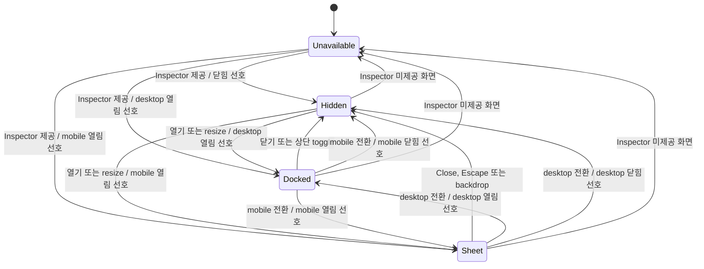
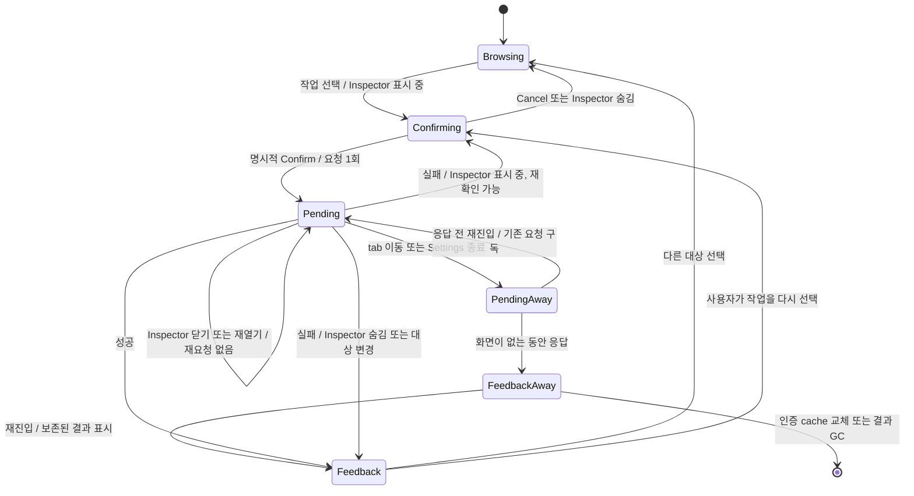
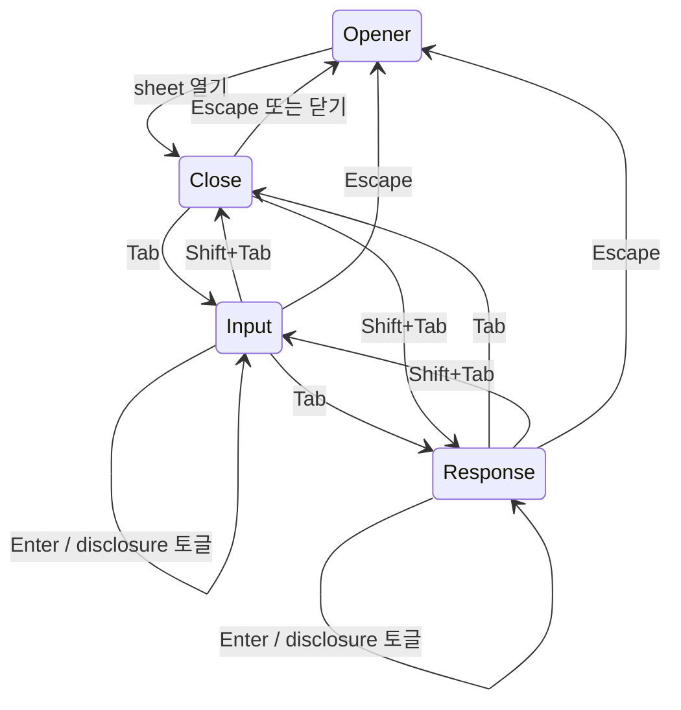

# Settings 상태 전환

Settings의 표시 상태와 기능별 작업 상태는 독립적이다. 이 문서는 기존 React state와 query mutation의 동작 계약을 FSM으로 표현한다. 별도 런타임 상태 머신이나 서버 API는 도입하지 않는다.

## 1. Inspector 표시 FSM



표시 상태는 `available`, 현재 viewport의 `open`, `isMobile`에서 계산한다. 사용 가능한 화면으로 돌아올 때 desktop의 열림 선호는 다시 적용할 수 있다. Mobile에서 Inspector를 제공하지 않는 화면으로 이동하면 열림 상태를 해제한다.

- Workbench는 표시 위치·열림 상태와 portal container를 소유한다.
- Feature는 선택 대상·확인 UI를 소유한다. Portal의 unmount를 feature의 unmount로 간주하지 않는다.
- 요청의 진행 상태·대상·결과는 인증별 query cache가 소유한다. Feature는 현재 작업을 구독해 잠금과 결과 안내를 복원한다.
- Inspector가 닫혀도 본문의 탐색·추가·필터는 사용할 수 있다. 진행 중 요청 때문에 일시적으로 비활성화하는 경우는 다음 FSM을 따른다.

## 2. 파괴적 작업 FSM

Account의 브라우저 로그아웃, Connections의 연결 해제, Agents의 삭제, Trash의 영구 삭제에 같은 닫기 규칙을 적용한다.



| 전환·경계 | 반드시 지킬 동작 |
| --- | --- |
| 확인 중 → Inspector 닫기 | 미확정 작업을 취소한다. 목록과 새로고침의 확인 상태 잠금을 해제한다. 요청은 보내지 않는다. |
| 요청 중 → Inspector 닫기 | 이미 보낸 요청을 취소·재전송하지 않는다. 요청 때문에 잠근 조작은 응답을 처리할 때까지 잠근다. |
| 닫힌 상태에서 응답 도착 | 성공·실패 결과를 보존하고 미확정 확인 상태를 해제한다. 다시 열 때 오래된 Confirm을 복구하지 않는다. |
| 표시 중 실패 | 사용자가 확인 후 재시도할 수 있다. Trash의 404·409는 확인을 해제하고 목록을 새로 조회한다. |
| Cancel | 실행 버튼으로 focus를 돌린다. Inspector 닫기는 sheet의 opener 복귀 규칙을 따른다. |
| viewport 변경 | 변경 후에도 Inspector가 표시된다면 확인 상태를 유지한다. 숨겨진다면 닫기 규칙을 적용한다. |
| tab 변경·Settings 종료 | UI의 확인 상태를 버린다. 요청은 query cache에서 계속 추적하며 재진입 시 잠금과 결과를 복원한다. |

`Away`는 feature가 unmount된 상태를 나타내는 명세상의 구분이다. 별도 서버 상태가 아니다. 인증별 query cache의 keyed mutation을 구독하며, `trash`, `revoke-browser/cli/mcp`, `delete-agent`의 작업 범위를 분리한다. 같은 범위의 요청이 진행 중이면 호출 시점에도 중복 실행과 reset을 막는다. 완료 결과는 사용자가 다른 대상을 선택하거나 새 작업을 확인할 때 해제하고, cache의 기존 GC 정책을 따른다. 브라우저 새로고침·로그아웃을 넘어 보존하지 않는다. API key 원문은 이 경로로 옮기지 않는다.

성공 후 서버 자원 갱신은 mutation callback이 수행한다. 화면 안내·선택 변경은 구독한 결과로 계산하므로 제거된 화면의 setState에 의존하지 않는다. Trash의 삭제 성공은 정리 완료가 아닌 `Deletion queued`다.

전환 처리 후의 불변 조건:

- Inspector 숨김 + 요청 없음 → 확인 상태 없음.
- 요청 중 → Inspector 표시 여부와 무관하게 요청으로 잠근 조작을 유지.
- 닫기·재열기·resize → mutation 전송 횟수 증가 없음.
- 요청 중 tab 왕복·Settings 재열기 → 새 요청 없이 기존 요청의 잠금과 결과 복원.
- 재시도 → 사용자의 명시적 Confirm 필요.

## 3. Mobile sheet의 focus FSM



이 도식은 다른 focusable content가 없는 호출 상세의 기본 순서다. Native `summary`도 Tab 순환에 포함한다. 명시적 autofocus가 있으면 유지하며, sheet 종료 중 새 화면으로 옮겨진 focus를 오래된 opener로 덮어쓰지 않는다.

## 전환 검증

- [`settings-transitions.spec.ts`](../../frontend/web/e2e/settings-transitions.spec.ts): desktop/mobile에서 4개 기능의 닫기 경로·재열기·resize, desktop tab 변경, 미전송 보장, 요청 중 Inspector·tab·Settings 재진입과 이후 성공·실패의 중복 전송 방지.
- [`useSettingsMutation.test.tsx`](../../frontend/web/src/features/settings/useSettingsMutation.test.tsx): 제거된 화면의 호출·reset 차단, 화면 부재 중 실패 보존, 완료 결과 복구·해제, 작업 범위와 인증 cache 격리.
- [`invocation-history.spec.ts`](../../frontend/web/e2e/invocation-history.spec.ts): 실제 mobile History Inspector의 summary 접근·Enter·Tab 양방향 순환과 기존 스크롤·선택 복원.
- [`Modal.test.tsx`](../../frontend/web/src/shared/ui/Modal.test.tsx): 공통 focus 순환, disabled/tabIndex 제외, autofocus와 opener 복귀.
- 기존 [`control-interactions.spec.ts`](../../frontend/web/e2e/control-interactions.spec.ts), [`account-access.spec.ts`](../../frontend/web/e2e/account-access.spec.ts), [`trash.spec.ts`](../../frontend/web/e2e/trash.spec.ts): tab 탐색·선택·취소·결과 안내·pagination 보존.

이 검증은 명시한 UI 전환을 실행하는 회귀 테스트다. 가능한 모든 비동기 interleaving에 대한 형식 검증을 의미하지 않는다.

## 반복해서 놓친 경계

최근 결함은 화면의 배치보다 상태의 수명과 전환에 집중돼 있었다.

```text
사용자 행동             Feature 수명       확인 UI       시작한 요청
----------------------------------------------------------------------
Inspector 닫기          유지               취소          유지
다른 tab으로 이동       제거               취소          유지
Settings 닫기           제거               취소          유지
----------------------------------------------------------------------
기존 문제 1: 취소할 확인 UI가 남음        -> 숨겨진 확인 때문에 목록 잠김
기존 문제 2: 유지할 요청 상태가 사라짐   -> 복귀 후 중복 요청, 늦은 오류 누락
```

이전 테스트는 각 화면과 Inspector 닫기, 실행 전 tab 변경을 검증했다. 요청이 끝나기 전 feature가 제거되고 재생성되는 조합은 빠졌다. FSM 문서의 요청 유지 규칙도 실제 상태 구독과 전환 테스트로 연결되지 않은 부분이 있었다.

Focus 문제는 별도의 계약 누락이었다. DOM이 교체된 뒤 focus를 어디로 돌릴지, native `summary`를 공통 Modal의 Tab 순환에 포함할지 빠져 있었다. 마우스 click이나 screenshot 검증만으로는 이 문제를 발견할 수 없었다.

따라서 화면별 검증에 더해 `작업 단계(확인/요청/결과) × 이동 방식(숨김/tab/종료) × 응답 시점(전/후)`의 경계를 확인한다. 공통 focus 처리는 실제 키보드 입력으로 검증한다.
